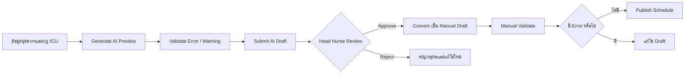
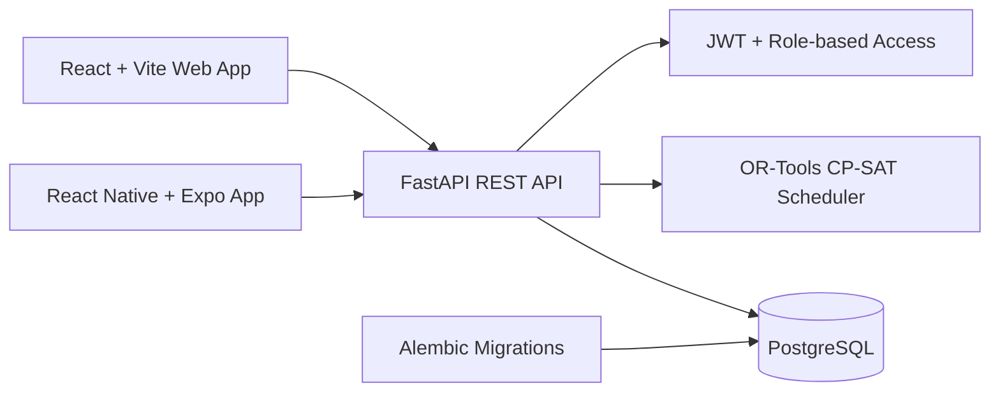

# AI Nurse Scheduling System

ระบบเว็บสำหรับจัดตารางเวรบุคลากรในหอผู้ป่วยวิกฤต (ICU) โดยรองรับทั้งการจัดเวรแบบ Manual และการสร้างตารางตัวอย่างด้วย AI Scheduler ระบบออกแบบตามแนวคิด **Human-in-the-loop**: AI ช่วยคำนวณ ตรวจเงื่อนไข และอธิบายผล แต่ Head Nurse ยังเป็นผู้ตรวจสอบ อนุมัติ และนำตารางไปใช้งานจริง

โปรเจกต์นี้ใช้ Google OR-Tools CP-SAT ในการหาตารางที่เป็นไปตามกฎ ICU พร้อมลดความไม่สมดุลของภาระงาน ความไม่ตรงกับความต้องการของบุคลากร และการทำงานล่วงเวลา โดย AI จะไม่เผยแพร่ตารางอัตโนมัติ

## จุดประสงค์ของโครงการ

- ลดเวลาและความซับซ้อนในการจัดตารางเวรรายเดือน
- ตรวจสอบจำนวน RN, PN/NA, Senior RN และ Incharge ในแต่ละช่วงเวลา
- ป้องกันการจัดเวรทับซ้อน เวรในวันลา และการพักไม่เพียงพอหลังเวรกลางคืน
- กระจายภาระงานและเวรกลางคืนอย่างเหมาะสม
- นำ Preference และ Availability ของบุคลากรมาช่วยประกอบการจัดเวร
- คงอำนาจตัดสินใจขั้นสุดท้ายไว้กับ Admin และ Head Nurse
- เก็บประวัติการตรวจสอบ การอนุมัติ และการเผยแพร่เพื่อให้ตรวจสอบย้อนหลังได้

## ความสามารถหลัก

### การจัดการผู้ใช้และข้อมูลบุคลากร

- เข้าสู่ระบบด้วย JWT และแบ่งสิทธิ์ตามบทบาท
- จัดการข้อมูลบุคลากร แผนก ประเภทเวร และวันหยุด
- กำหนด RN, Nurse Assistant, Head Nurse และ Senior RN
- ปิดใช้งานและนำบัญชีบุคลากรกลับเข้าระบบโดยไม่ลบประวัติตารางเวรเดิม

### วันลา Availability และ Preference

- บุคลากรส่งคำขอลาและติดตามสถานะได้
- Admin/Head Nurse อนุมัติหรือปฏิเสธคำขอลา
- บันทึกวันที่ไม่สะดวกทำงานแบบทั้งวันหรือเฉพาะประเภทเวร
- ระบุเวรที่ต้องการ (`prefer`) หรือควรหลีกเลี่ยง (`avoid`)
- Approved Leave และ Unavailable เป็นข้อบังคับที่ AI ห้ามฝ่าฝืน ส่วน Preference เป็นเงื่อนไขแบบยืดหยุ่น

### การจัดตารางเวรแบบ Manual

- สร้างและแก้ไขตารางเวรรายเดือน
- เพิ่ม ลบ และล็อก Assignment รายบุคคล
- ตรวจ Error/Warning ตามกฎ ICU ก่อนเผยแพร่
- Error จะบล็อกการ Publish ส่วน Warning จะถูกบันทึกไว้ในประวัติ
- ตารางที่เผยแพร่แล้วถูกล็อก และสามารถเปิดกลับเป็น Draft revision พร้อม Audit Log

### AI Scheduler

- สร้างตาราง Preview ด้วย Google OR-Tools CP-SAT
- ตรวจ Hard Constraints เช่น จำนวนบุคลากร วันลา เวรทับซ้อน เวลาพัก Senior RN และ Incharge
- Optimize Soft Constraints ด้าน Fairness, Preference และ OT
- แสดง Solver Status: `OPTIMAL`, `FEASIBLE`, `INFEASIBLE`, `UNKNOWN` หรือ `MODEL_INVALID`
- แสดง Workload, ชั่วโมงทำงาน, OT และเวรกลางคืนรายบุคคล
- อธิบาย Fairness, Night Distribution, Preference และ Trade-off ของแต่ละคน
- AI Preview เป็นข้อมูลชั่วคราวและยังไม่เขียนทับตารางจริง

### Human Approval Workflow



AI ไม่มีสิทธิ์ Auto-publish ตาราง ตารางที่สร้างโดย AI ต้องผ่านการ Validate, อนุมัติโดย Head Nurse และตรวจสอบก่อน Publish ทุกครั้ง

## คะแนนคุณภาพตาราง (0–10)

หน้า AI Preview แสดงคะแนนคุณภาพเพื่อให้อ่านผลได้ง่าย โดยคำนวณจาก:

| องค์ประกอบ | สัดส่วน | ความหมาย |
|---|---:|---|
| ความสมดุลของภาระงาน | 50% | เปรียบเทียบความแตกต่างของ Workload ระหว่างบุคลากร |
| ความสอดคล้องกับ Preference | 25% | พิจารณาเวรที่ต้องการและเวรที่ควรหลีกเลี่ยง |
| การลด OT | 25% | พิจารณาปริมาณชั่วโมงล่วงเวลาเฉลี่ย |

คะแนนสูงหมายถึงตารางมีความสมดุลและตรงกับเป้าหมายมากขึ้น แต่ **คะแนนนี้ไม่ใช้แทนการตรวจ Error/Warning ด้านความปลอดภัย** ตารางต้องผ่าน ICU Validator ก่อนอนุมัติและเผยแพร่เสมอ

## กฎสำคัญที่ระบบตรวจสอบ

### Hard Constraints

- บุคลากรหนึ่งคนมีได้ไม่เกินหนึ่งเวรต่อวัน
- ห้ามจัดเวรในวันที่ลาได้รับอนุมัติหรือระบุว่าไม่พร้อมทำงาน
- จำนวน RN และบุคลากรสนับสนุนต้องครอบคลุมแต่ละช่วงเวลา
- ต้องมี Senior RN และ Incharge ตามค่าที่กำหนด
- Incharge ต้องเป็นผู้มีคุณสมบัติและต้องถูกจัดอยู่ในเวรนั้นจริง
- ห้ามเวรที่เวลาทับซ้อนกัน และต้องมีเวลาพักหลังเวร N/DE
- Head Nurse ทำเวรได้เฉพาะ AM หรือ D รวมถึงสามารถลา/Off ได้ตามปกติ

### Soft Constraints

- กระจายภาระงานให้ใกล้เคียงกัน
- พยายามทำตาม Preference ของบุคลากร
- ลดชั่วโมง OT
- รายงานการกระจายเวรกลางคืนเพื่อประกอบการตรวจสอบ

## บทบาทผู้ใช้งาน

| บทบาท | สิทธิ์หลัก |
|---|---|
| `admin` | จัดการข้อมูลหลัก ผู้ใช้ กฎ ICU ระบบ และตารางเวร |
| `head_nurse` | จัดการตาราง ตรวจและอนุมัติ/ปฏิเสธ AI Draft แปลงเป็น Manual Draft และเผยแพร่ |
| `nurse` | ดูตารางและเวรของตน ส่งคำขอลา บันทึก Availability และ Preference |
| `nurse_assistant` | ดูตารางและเวรของตน ส่งคำขอลา บันทึก Availability และ Preference |

## สถาปัตยกรรมระบบ



| ส่วน | เทคโนโลยี |
|---|---|
| Web Frontend | React, TypeScript, Vite |
| Mobile App | React Native, Expo SDK 54 |
| Backend API | Python, FastAPI, Pydantic |
| AI/Optimization | Google OR-Tools CP-SAT |
| Database | PostgreSQL, SQLAlchemy |
| Database Migration | Alembic |
| Authentication | JWT, bcrypt, Role-based Access Control |
| Testing | unittest, Vitest, Playwright |
| Deployment | Docker, Render Blueprint |

## ข้อมูลหลักในระบบ

- ผู้ใช้และสิทธิ์ (`users`)
- บุคลากรและแผนก (`staffs`, `departments`)
- ประเภทเวรและช่วง Coverage (`shift_types`, `coverage_windows`)
- วันลาและ Availability (`leave_requests`, `availability`)
- Preference รายบุคคล (`staff_shift_preferences`)
- ตารางเวรและ Assignment (`schedules`, `schedule_details`)
- AI Draft และรายละเอียดตารางจาก AI
- กฎ ICU และการตั้งค่าระบบ
- Validation History และ Schedule Audit Log

ระบบไม่จำเป็นต้องเก็บข้อมูลผู้ป่วย การนำข้อมูลบุคลากรจริงมาทดสอบควรปกปิดชื่อและข้อมูลส่วนบุคคลก่อนเสมอ

## โครงสร้างโปรเจกต์

```text
AI-Nurse-Scheduling/
├── backend/                 FastAPI, CP-SAT, Models, Services และ Tests
├── frontend/                React/Vite Web Application
├── mobile/                  React Native/Expo Application (Phase 1)
├── docs/                    เอกสารกฎ ICU และคู่มือระบบ
├── tools/                   Script สำหรับเปิดและตรวจระบบบน Windows
├── docker-compose.yml       Local Docker stack
├── Dockerfile.production    Production image: Frontend + Backend
├── render.yaml              Render deployment blueprint
└── OPEN_ICU_SYSTEM.cmd      ตัวเปิดระบบสำหรับ Windows
```

## เริ่มใช้งานบน Windows

วิธีที่ง่ายที่สุดสำหรับสภาพแวดล้อมที่ตั้งค่าไว้แล้ว:

```powershell
.\OPEN_ICU_SYSTEM.cmd
```

ตัวเปิดระบบจะตรวจ PostgreSQL, Backend, Frontend และ Expo ก่อนเปิดหน้าเว็บ

## เริ่มใช้งานด้วย Docker Compose

1. ติดตั้ง Docker Desktop
2. คัดลอกไฟล์ตั้งค่าและเปลี่ยนรหัสผ่านทั้งหมด

```powershell
Copy-Item .env.example .env
```

3. เปิดระบบ

```powershell
docker compose up --build
```

- Web Application: `http://localhost:8080`
- API Documentation: `http://localhost:8000/docs`
- Health Check: `http://localhost:8000/health`

ระบบจะรัน Alembic migration และสร้างบัญชี `admin` จาก `ADMIN_INITIAL_PASSWORD` ในการเริ่มต้นครั้งแรก ห้ามนำรหัสผ่านตัวอย่างไปใช้กับระบบออนไลน์

## เริ่มใช้งานแบบไม่ใช้ Docker

### Backend

```powershell
cd backend
Copy-Item .env.example .env
python -m venv .venv
.\.venv\Scripts\python.exe -m pip install -r requirements.txt
.\.venv\Scripts\python.exe -m alembic upgrade head
.\.venv\Scripts\python.exe -m app.seed
.\.venv\Scripts\python.exe -m uvicorn app.main:app --reload --port 8001
```

### Frontend

```powershell
cd frontend
corepack enable
pnpm install
pnpm dev
```

กำหนด `VITE_API_URL` ใน `frontend/.env` ให้ตรงกับ Backend ที่ใช้งาน

## แอปมือถือ

แอป Expo Phase 1 รองรับ Login, Dashboard, เวรของฉันวันนี้ และรายชื่อ Senior RN แบบ Read-only:

```powershell
cd mobile
npm install
npx expo start
```

เมื่อนำ Backend ขึ้นออนไลน์ สามารถใส่ URL เช่น `https://your-domain.example/api/v1` ในหน้า Login ของแอปได้

## การทดสอบ

### Backend

```powershell
cd backend
.\.venv\Scripts\python.exe -m unittest discover -s tests
.\.venv\Scripts\python.exe -m alembic heads
```

### Frontend

```powershell
cd frontend
pnpm test
pnpm run build
```

ผลตรวจสอบล่าสุด: Backend ผ่าน 65 tests (ข้าม PostgreSQL integration 6 tests เมื่อไม่ได้กำหนดฐานทดสอบ), Frontend ผ่าน 10 tests และ Production build ผ่าน

## การนำขึ้นออนไลน์

โปรเจกต์มี `Dockerfile.production` และ `render.yaml` สำหรับให้ Frontend และ API ทำงานผ่าน HTTPS จากโดเมนเดียว พร้อม PostgreSQL แยกบนคลาวด์ ดูขั้นตอนได้ที่ [Public Deployment Guide](docs/PUBLIC_DEPLOYMENT.md)

> `render.yaml` ตั้งค่า Free plan สำหรับสาธิตโปรเจกต์เท่านั้น ฐานข้อมูลฟรีมีข้อจำกัดและไม่เหมาะกับข้อมูลโรงพยาบาลจริง ก่อนใช้งานระยะยาวต้องเลือกแผนที่มีการสำรองข้อมูล เปลี่ยนรหัสผ่านทั้งหมด และตรวจนโยบายความปลอดภัยของหน่วยงาน

## ความปลอดภัยและความเป็นส่วนตัว

- ห้าม Commit `.env`, รหัสผ่าน, JWT secret, ไฟล์ฐานข้อมูล หรือ Log ขึ้น GitHub
- ใช้รหัสผ่าน production อย่างน้อย 12 ตัว และ JWT secret อย่างน้อย 32 ตัว
- ใช้ HTTPS และไม่เปิดพอร์ต PostgreSQL สู่สาธารณะ
- ใช้ Repository แบบ Private หากมีข้อมูลหรือไฟล์สำหรับการทดลองภายใน
- ใช้ข้อมูลบุคลากรที่ De-identify แล้วสำหรับการสาธิตและการทดสอบ
- ระบบเป็นเครื่องมือช่วยตัดสินใจ ตารางทุกฉบับต้องได้รับการตรวจโดยผู้รับผิดชอบก่อนใช้งานจริง

## เอกสารเพิ่มเติม

- [สถานะโครงการ](PROJECT_STATUS.md)
- [สถาปัตยกรรมระบบ](ARCHITECTURE.md)
- [API Specification](API_SPEC.md)
- [AI Scheduler Design](AI_SCHEDULER_DESIGN.md)
- [Database Schema](DATABASE_SCHEMA.md)
- [ICU Rule Configuration](docs/ICU_RULE_CONFIGURATION.md)
- [Clinical Pilot Checklist](docs/CLINICAL_PILOT_CHECKLIST.md)
- [Public Deployment Guide](docs/PUBLIC_DEPLOYMENT.md)

## สถานะปัจจุบัน

ระบบพร้อมในระดับ **Manual Scheduling + AI-assisted Scheduling + Human Approval Workflow** สำหรับการสาธิต การทดสอบด้วยข้อมูลจำลอง และการเตรียม Clinical Pilot ระบบยังไม่ใช่ Production Hospital System และไม่ควรนำไปตัดสินใจด้านการจัดกำลังคนโดยปราศจากการตรวจสอบจาก Head Nurse หรือผู้รับผิดชอบ
